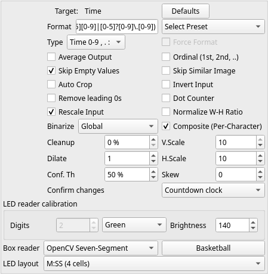

# Calibrated LED digits and clocks

Select **OpenCV Seven-Segment** as the box reader. For a clock, choose field type
**Time**, select an **LED layout**, and enable **Composite (Per-Character)**.
Use the plus button inside the scene box to add one rectangle per digit and
separator. Position cells around the complete symbols; the reader orders them
left to right. Separator rectangles must span the same vertical height as the
digits so the reader can distinguish low decimal dots from colon dots.

| LED layout | Cells, left to right |
| --- | --- |
| MM:SS | Digit, digit, colon, digit, digit |
| M:SS | Digit, colon, digit, digit |
| SS.t | Digit, digit, decimal point, digit |
| S.t | Digit, decimal point, digit |

Choose the actual LED color and brightness. Cells must lie inside the box and
must not overlap. Unknown digit patterns, missing punctuation, missing trailing
digits, and seconds of 60 or greater in colon layouts are rejected. Entirely
unlit cells return a physical blank; zero remains a number. A leading unlit digit
is allowed, but an entirely missing minutes/seconds part is not.

For numeric fields, **Number** uses equal-width cells by default. Enabling
Composite lets you calibrate separate positions for one to three digit cells;
match the **Digits** control to the number of cells. This helps when the complete
field crop has margins or the digits are not evenly spaced within it.

The existing countdown confirmation applies to these readings. Editing a cell
resets confirmation, just like changing a field box or reader. The reader only
returns observed values; it does not extrapolate time or insert an unseen
separator. Tesseract and PP-OCR continue to use the complete field crop.

Layouts are explicitly selected. A display that changes physical layout below
one minute needs a corresponding calibration/layout change; automatic switching
is not implemented. Synthetic tests cover the layouts, malformed punctuation,
zero/blank distinctions, countdown ticks and cell edits. End-to-end accuracy on
physical clocks is still unvalidated. Some supplied green clock crops have
merged glare with no independently legible punctuation, so they cannot establish
that this separator reader works on that display.
