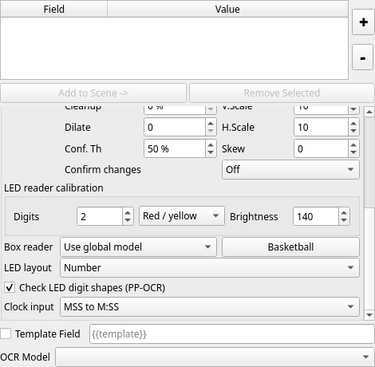

# Check LED digit shapes in PP-OCR

For a physical LED number or clock, select **PP-OCRv4 + TTA** and enable
**Check LED digit shapes (PP-OCR)** per box. It defaults to off. It does not
change general text, Tesseract, or the calibrated OpenCV reader. The Basketball
button preserves this choice. Changing it resets confirmation.

The reader examines bright cores, digit proportions and enclosed holes. It
rejects tall strokes clipped by the left/right crop edge. On disagreement or
missing digits, it retries a tighter RGB crop or a binary image of the observed
bright cores. Complete shapes must agree with neural recognition. Partial
shapes constrain a retry's prefix/suffix and minimum digit count; they cannot
publish a digit by themselves. Unknown evidence can still leave the original
neural result unchanged. Glare, merged segments and different displays remain
limitations; this is an optional check, not an accuracy guarantee.

Warm cores use minimum-channel brightness 160; predominantly green LEDs use
240 to remove their stronger glare. These fixed thresholds were developed on
one display. Every published candidate comes from actual PP-OCR inference with
its actual confidence; no predicted ticks or shape-only substitutions are used.

For **Time** fields, choose **Clock input** to declare the physical format:

| Choice | Required input | Formatted output |
| --- | --- | --- |
| Read displayed separators | Observed text | Unchanged |
| MSS | Three digits | M:SS |
| MMSS | Four digits | MM:SS |
| SSt | Three digits | SS.t |
| St | Two digits | S.t |
| Integer seconds | One/two digits, below 60 | Integer seconds |

Compact formats require all digits and reject invalid seconds. Already
formatted matching text is accepted. Separators are inserted only through this
explicit setting; the default continues to require observed punctuation.
Integer seconds uses shorter neural padding. Select a decimal mode when the
physical shot clock switches to tenths; automatic layout switching is absent.



## Camera evidence

The original development frames now recover the accepted 7-to-1 and 14-to-4
errors, plus previously rejected score 11, foul 1, shot clock 17, and green 7:41.
These are development examples. The chronological benchmark uses the actual
application OCR, regex and confirmation path:

| 203 reviewed sequence samples | Correct accepted | Wrong accepted | Rejected |
| --- | --- | --- | --- |
| Baseline, explicit clock format | 84 | 40 | 79 |
| LED check, same clock format | 140 | 0 | 63 |

Three output samples retain the previous score while confirming a real change;
these are stale outputs, despite zero newly accepted wrong values. Score change
delays are 0.20–0.27 seconds relative to the first sampled visible change.
The stopped green clock takes 1.80 seconds to acquire; subsequent clipped frames
are rejected while its last confirmed value remains displayed. A blank shot
clock is unknown to this neural reader, so it cannot clear an existing value.
Capture and model-loading delays are excluded. See the complete
[sequence results](../results/ocr_video_benchmark/sequence_readers_verified.json).

The 94 previously reviewed additional fields are now a regression corpus:
both readers accept all 94 correctly. An early policy rejected a merged 10;
subsequent topology/partial-digit changes used that evidence, so this corpus is
not held out. The final result and source/model hashes are in
[regression results](../results/ocr_video_benchmark/led_check_regression.json).
Ten new crops were labeled after freezing the final policy and before inference;
both readers accept all ten correctly. The frozen hashes are checked by the
[held-out runner](../tools/ocr_benchmark/heldout_led_check.py), with
[results](../results/ocr_video_benchmark/heldout_led_check.json).

All footage is from the same display/session. Sequence crops were used during
development; the ten fresh crops are nearby score frames and provide limited
additional evidence. Another game/camera and real tenths transitions are still
needed before broad accuracy claims or enabling this option by default.

## Reproduce

```sh
PYTHONPATH=src .venv/bin/python tools/ocr_benchmark/sequence_readers.py --output /tmp/sequences.json
.venv/bin/python tools/ocr_benchmark/heldout_led_check.py --output /tmp/heldout.json
.venv/bin/python tools/ocr_benchmark/led_check_validation.py --videos /path/to/Videos/Camera --output /tmp/regression.json
```

Processing timings are CPU-only and depend on retries. In this run integer
shot-clock mode reduced median processing from 48 to 21 ms on the 14 sequence
with unchanged outcomes. Clocks requiring compact/decimal formatting keep the
original wider padding because reducing it hurt recognition coverage.

See [timestamp-paced playback and bounded glare retries](realtime-playback.md)
for the follow-up latency measurements and green-clock improvements.
